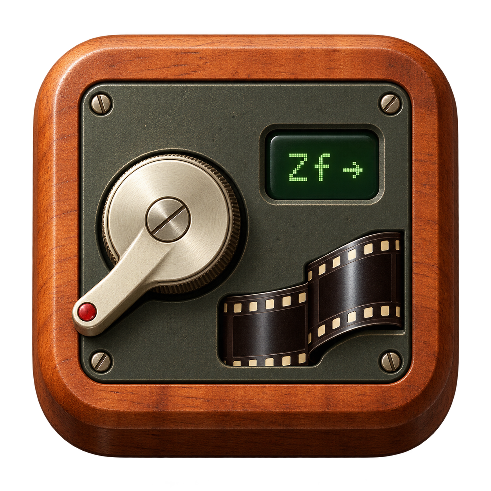
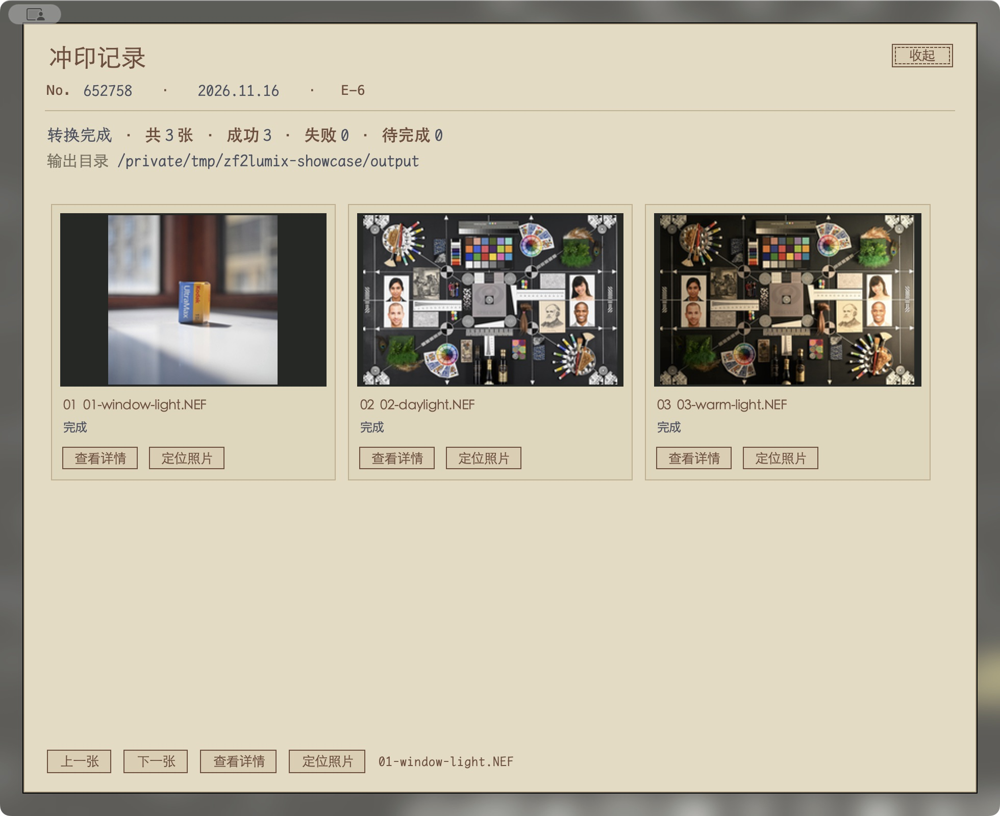
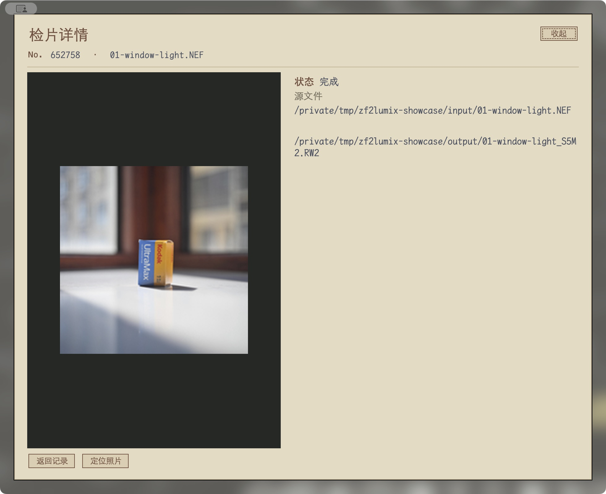

<p align="center">
  
</p>
<h1 align="center">Zf2Lumix</h1>
<p align="center">Nikon Zf · 14-bit NEF → S5M2-compatible RW2</p>
<p align="center">
  <a href="https://jay201368.github.io/zf2lumix/">界面与操作</a> ·
  <a href="https://github.com/JAY201368/zf2lumix/releases/latest">下载 macOS 版</a> ·
  <a href="docs/guide.md">使用与构建</a>
</p>


将 Nikon Zf 的 NEF 转换为 S5M2 兼容 RW2，供 LUMIX Lab 导入。转换在本机离线完成，生成 RW2 与逐张 JSON 转换记录，保留原始 NEF。

## 从胶片到记录

**导入照片 → 选择输出位置 → 旋钮选择校准 → 转换 → 检片**

| 照片 | 转换 | 记录 |
| --- | --- | --- |
| 文件与文件夹拖入、批量导入 | 自动、日光、暖光三挡校准 | 逐张成功、失败与等待状态 |
| 连续胶片、多选、移除与单步撤销 | 根据拍摄白平衡选择或插值 | 全窗纸质登记页、缩略图清单 |
| 双击查看预览与详情 | RAW 样本回读、裁切校验 | 返回记录、定位照片与错误详情 |

<table>
<tr>
<td width="50%"><br><sub>冲印记录 · 批次、缩略图与结果</sub></td>
<td width="50%"><br><sub>检片详情 · 预览、来源与输出</sub></td>
</tr>
</table>

红木外壳、深绿控制面板、点阵显示与纸签延续在实际操作中。旋钮拖动后吸附到挡位，转换键保持下沉，机械指针和 LCD 随实际处理进度更新。界面截图取自 macOS 实际运行。

## 开始使用

从 [Releases](https://github.com/JAY201368/zf2lumix/releases/latest) 下载 `Zf2Lumix-1.0.1-macOS-arm64.zip`，解压后打开 `Zf2Lumix.app`。Apple Silicon 版本已随附 Python 与转换依赖。首次打开遇到系统拦截时，可在系统设置的「隐私与安全性」中允许打开该应用。应用采用本地签名。

1. 点击「导入」或拖入 NEF 文件、文件夹。
2. 选择输出文件夹，通常使用「自动」校准。
3. 点击「转换」，完成后通过「打开」访问 RW2。
4. 点击纸签查看本批记录，双击照片查看详情。

| 输入与输出 | 支持范围 |
| --- | --- |
| 相机与格式 | Nikon Zf，14 位 RGGB NEF |
| 全幅 / 1∶1 | 有效画面 6000 × 4000 / 4000 × 4000，按源裁切保持构图 |
| 校准 | ISO 100–12800 校准点，中间档对数插值，超出范围使用边界参数并提示 |
| 文件保存 | 原片哈希核对、输出重名另存、逐张 JSON 记录 |
| 输出磁盘 | 需要支持硬链接，建议本地 APFS |
| 平台 | macOS Apple Silicon |

LUMIX Lab 既有对照覆盖 ISO800 标准格调样本。内嵌预览由 LibRaw 生成。详细兼容性与验证范围见 [使用与构建](docs/guide.md)。

## 从源码运行

macOS 需要 Python 3.12、可用的 Tk 和 C++ 编译器。在仓库根目录运行以下命令。

```sh
cd converter
python3.12 -m venv .venv
.venv/bin/python -m pip install -r requirements.txt
clang++ -std=c++17 -O3 encode_pana8.cpp -o encode_pana8
.venv/bin/python app.py
```

命令行批处理使用相同的转换核心。

```sh
.venv/bin/python converter.py /path/to/photos -o /path/to/output
```

[构建与模块说明](docs/guide.md#开发与构建) · [RAW 显影后端](docs/raw-development.md)

## 许可

原创源码与项目拟合参数采用 [MIT](LICENSE)。第三方代码、字体及依赖沿用各自许可，详见 [第三方声明](converter/THIRD_PARTY_NOTICES.md)。
